<p align="center">
  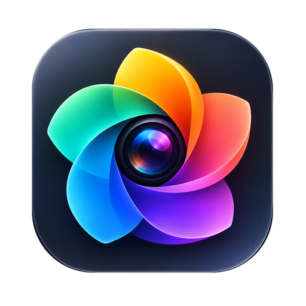
</p>

<h1 align="center">VistoGallery</h1>

<p align="center">
  A fast, private photo and video gallery for macOS.<br/>
  Browse, edit, tag and clean up your library. Everything stays on your disk.
</p>

<p align="center">
  <a href="https://github.com/Davin-X/visto-gallery/releases"></a>
  <a href="https://github.com/Davin-X/visto-gallery/actions/workflows/ci.yml"></a>
  <a href="LICENSE"></a>
  
</p>

<p align="center">
  <picture>
    <source media="(prefers-color-scheme: dark)" srcset="docs/screenshots/library-dark.jpg">
    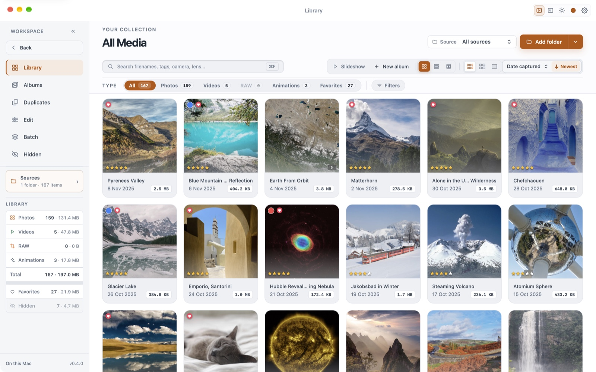
  </picture>
</p>
<p align="center"><sub>Shown in your GitHub theme. Every screen in the <a href="#tour">tour</a> appears in both light and dark.</sub></p>

VistoGallery points at the folders you already have. It never copies, moves or uploads your files; it builds a local catalog next to them so you can browse thousands of photos and videos quickly, organize them, and find duplicates.

## Contents

- [Features](#features)
- [Tour](#tour)
- [Install](#install)
- [Supported formats](#supported-formats)
- [Keyboard shortcuts](#keyboard-shortcuts)
- [Privacy](#privacy)
- [Build from source](#build-from-source)
- [How it works](#how-it-works)
- [Troubleshooting](#troubleshooting)
- [Contributing](#contributing)

## Features

- **Private by default.** No account, no cloud, no telemetry. Update checks are off unless you turn them on.
- **Your folders, in place.** Add folders as sources; files are read where they are. Moved or renamed files keep their favorites, tags and albums.
- **Browse your way.** Grid, Details, Timeline, Filmstrip and Overview layouts, sorted by capture date, name, size or type.
- **Find anything.** Search names, tags, camera and lens. Filter by capture date, rating, color label, camera, lens, source and type (photos, videos, RAW, animations).
- **Organize.** Albums, Smart Albums that update themselves, tags, favorites, ratings, color labels and hidden items.
- **Edit without fear.** Exposure, contrast, highlights, shadows, warmth, saturation, crop, rotate and flip. Edits are drafts until you save, and the original is kept so you can restore it.
- **Clean up duplicates.** SHA-256 matching finds exact copies, then a side-by-side compare shows what differs before anything moves to the Trash.
- **Export in batches.** Convert to JPEG, PNG or WebP, or keep the original format, with naming patterns, resizing and metadata stripping.
- **Feels like a Mac app.** Finder tags, Reveal in Finder, Trash with Put Back, light, dark and system themes, and accent colors.
- **Portable catalog.** Back up and restore the catalog, or point it at a library that moved to a new drive.

## Tour

### Albums and Smart Albums

<table>
  <tr>
    <th>Light</th>
    <th>Dark</th>
  </tr>
  <tr>
    <td>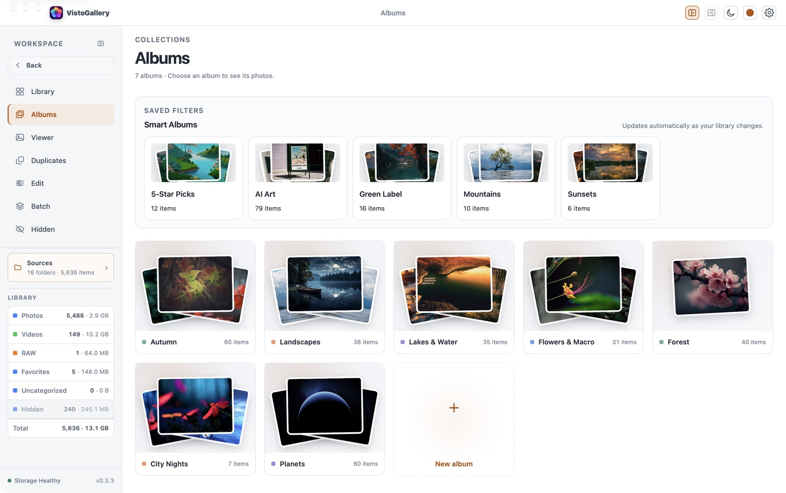</td>
    <td>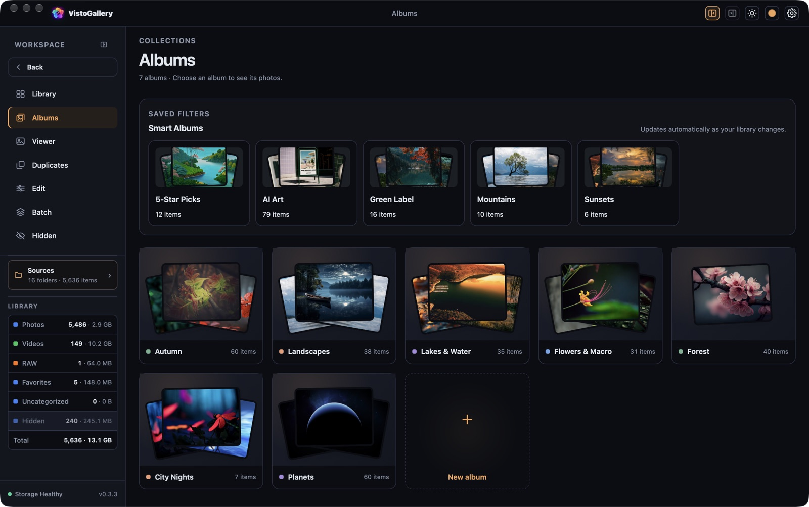</td>
  </tr>
</table>

Smart Albums are saved filters (for example "5-star picks" or "Sunsets") that stay current as your library changes.

### Album view

<table>
  <tr>
    <th>Light</th>
    <th>Dark</th>
  </tr>
  <tr>
    <td>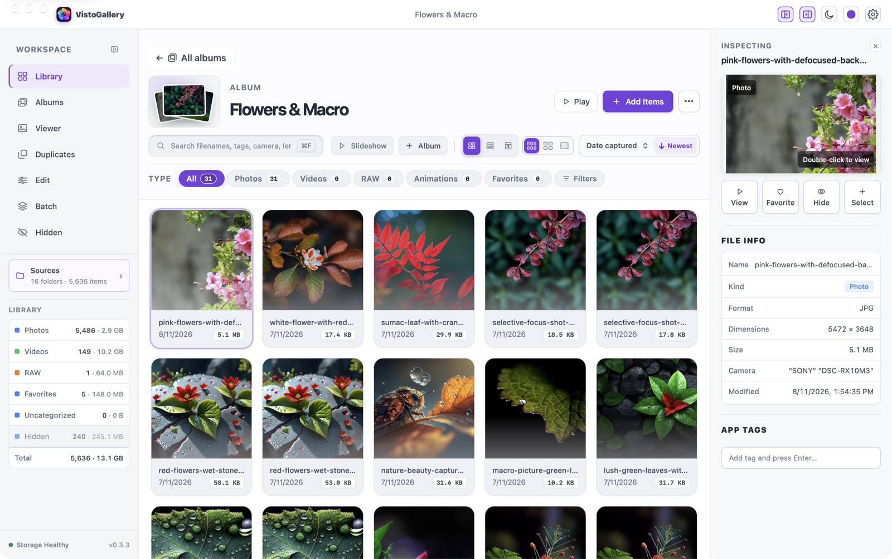</td>
    <td>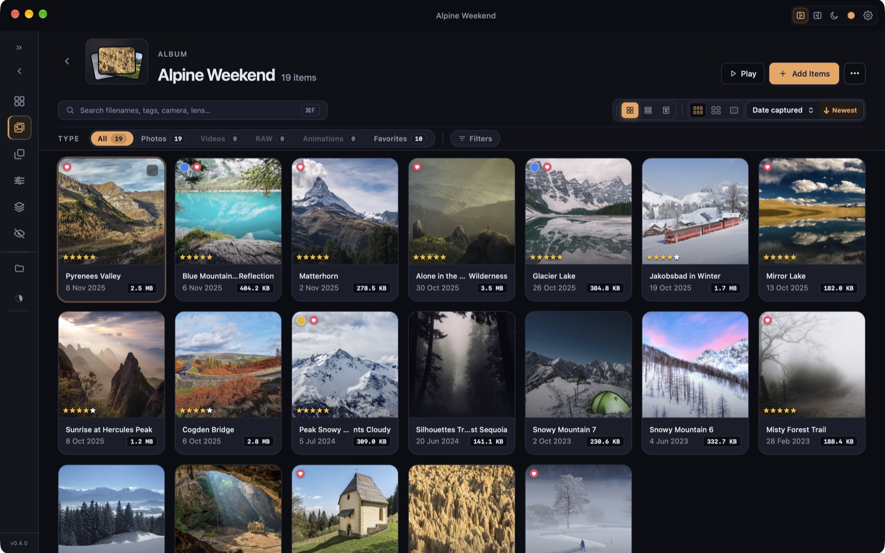</td>
  </tr>
</table>

Open an album to see just its photos. The inspector follows the selected item and shows its file details, tags and actions.

### Viewer

<table>
  <tr>
    <th>Light</th>
    <th>Dark</th>
  </tr>
  <tr>
    <td>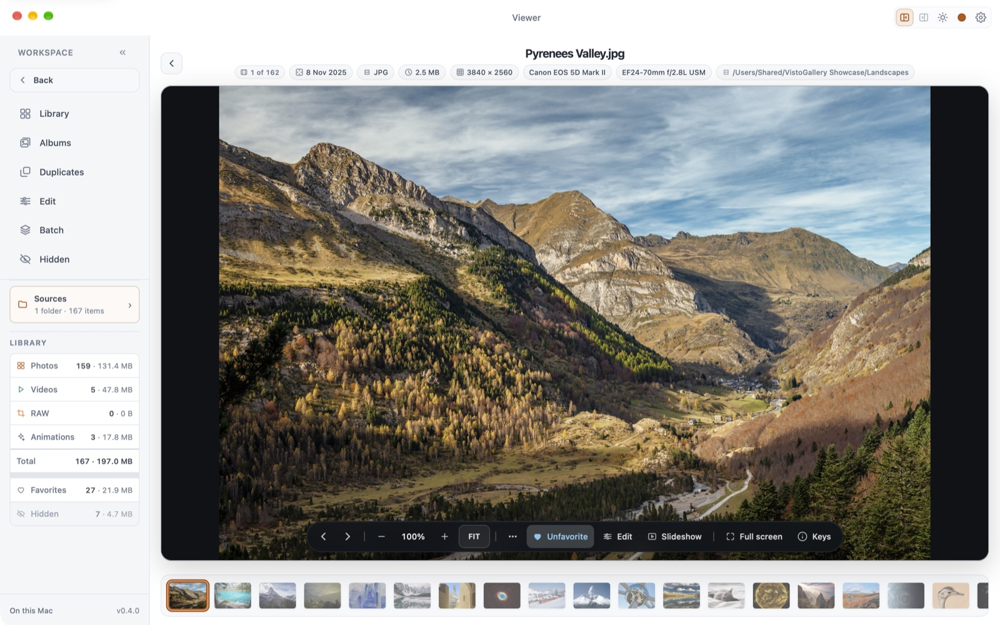</td>
    <td>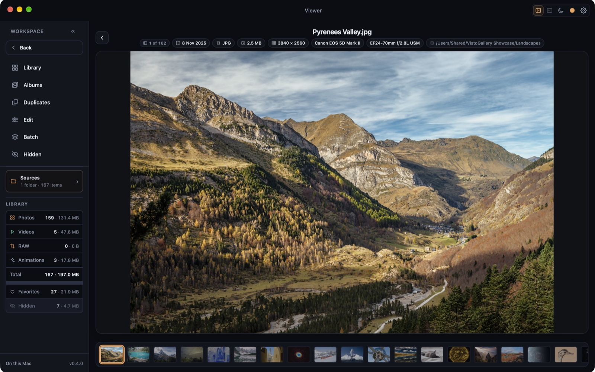</td>
  </tr>
</table>

Zoom, rotate, favorite and hide without leaving the photo. The filmstrip shows the rest of the folder.

### Edit

<table>
  <tr>
    <th>Light</th>
    <th>Dark</th>
  </tr>
  <tr>
    <td>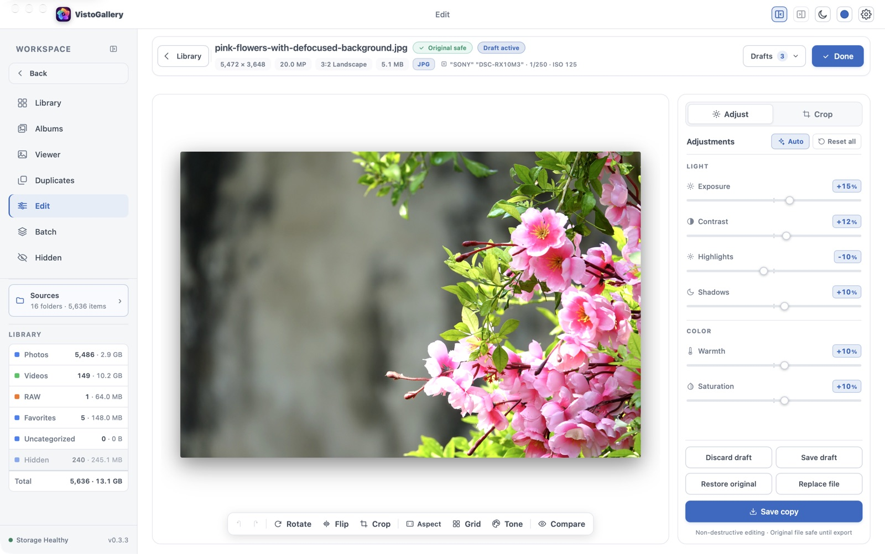</td>
    <td>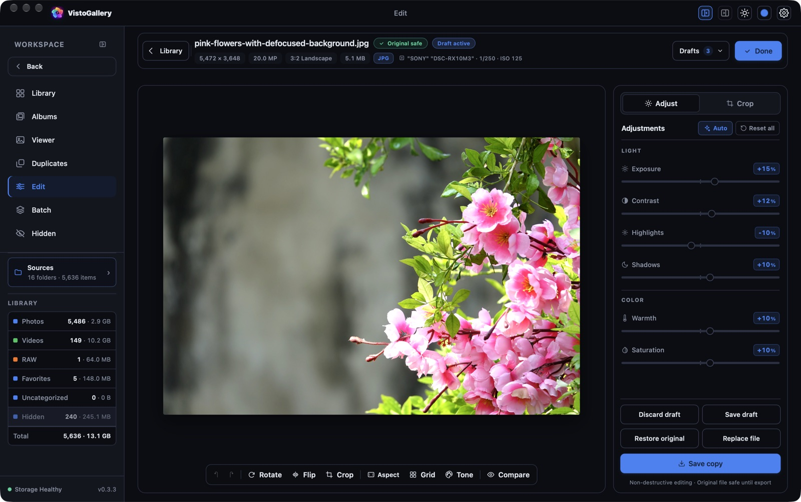</td>
  </tr>
</table>

Adjustments are saved as drafts. Save a copy, or replace the file knowing the original is kept and can be restored.

### Duplicates

<table>
  <tr>
    <th>Light</th>
    <th>Dark</th>
  </tr>
  <tr>
    <td>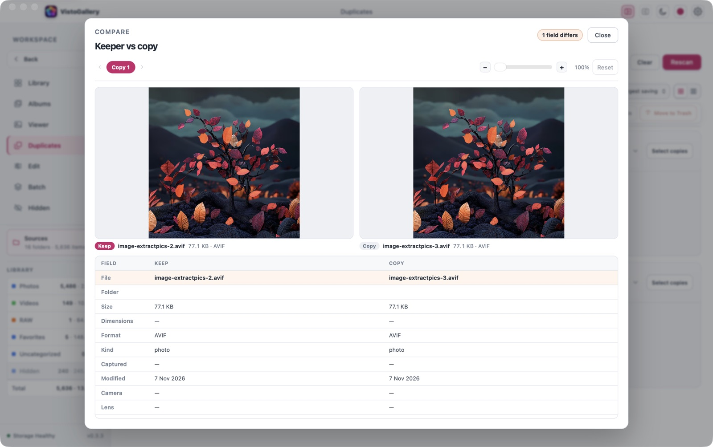</td>
    <td>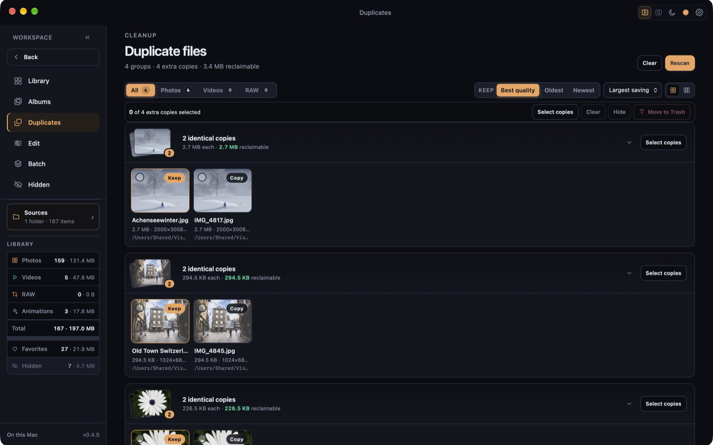</td>
  </tr>
</table>

Compare a keeper and its copies side by side, with synced zoom and a field-by-field diff, before moving copies to the Trash.

### Sources

<table>
  <tr>
    <th>Light</th>
    <th>Dark</th>
  </tr>
  <tr>
    <td>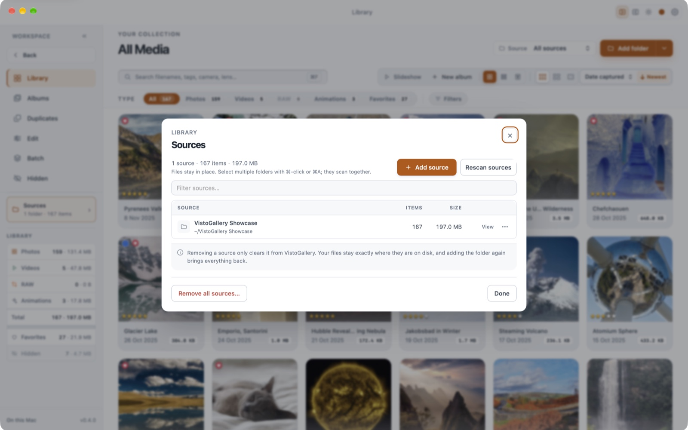</td>
    <td>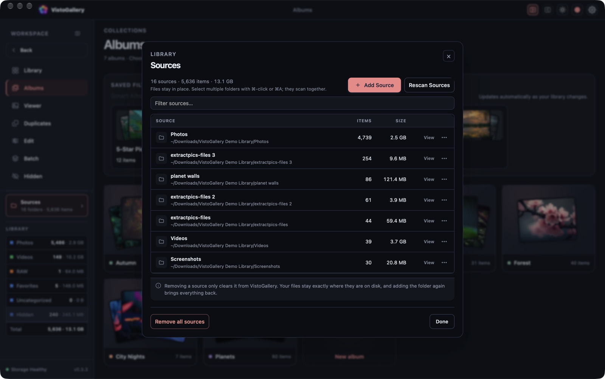</td>
  </tr>
</table>

Add, rescan or remove folders. Removing a source only removes it from the catalog; your files stay on disk.

## Install

1. Download the latest `.dmg` from [GitHub Releases](https://github.com/Davin-X/visto-gallery/releases).
2. Open it and drag **VistoGallery.app** into **Applications**.
3. Eject the disk image and open the app.

### macOS Gatekeeper (unsigned build)

VistoGallery is not notarized yet, so macOS may say the app is "damaged" or from an unidentified developer. Either right-click the app, choose **Open**, then **Open** again, or run:

```bash
xattr -dr com.apple.quarantine /Applications/VistoGallery.app
```

## Supported formats

| Type | Extensions |
|---|---|
| Photos | AVIF, BMP, GIF, HEIC/HEIF, JPEG (`jpg`, `jpeg`, `jpe`, `jfif`), JPEG XL, PNG, TIFF, WebP |
| RAW | 3FR, ARI, ARW, BAY, CAP, CR2, CR3, DCR, DCS, DNG, DRF, EIP, ERF, FFF, GPR, IIQ, K25, KDC, MDC, MEF, MOS, MRW, NEF, NRW, OBM, ORF, PEF, PTX, PXN, R3D, RAF, RAW, RW2, RWL, SR2, SRF, SRW, X3F |
| Video | 3GP, 3G2, ASF, AVI, FLV, M2TS, M4V, MKV, MOV, MP4, MPEG/MPG, MTS, OGV, TS, VOB, WebM, WMV |

Videos that WebKit can't play in the app (such as MKV and AVI) open in an installed player like IINA or VLC. Animated GIF, WebP, APNG and AVIF files are detected from their contents and appear under **Animations**.

## Keyboard shortcuts

| Shortcut | Action |
|---|---|
| <kbd>⌘</kbd> <kbd>O</kbd> | Add a source folder |
| <kbd>⌘</kbd> <kbd>I</kbd> | Import files |
| <kbd>⌘</kbd> <kbd>E</kbd> | Export selection with Batch |
| <kbd>⌘</kbd> <kbd>F</kbd> | Search |
| <kbd>⌘</kbd> <kbd>A</kbd> | Select or deselect all |
| <kbd>⌘</kbd> <kbd>\\</kbd> | Toggle sidebar |
| <kbd>⌘</kbd> <kbd>⌥</kbd> <kbd>I</kbd> | Toggle inspector |
| <kbd>⌘</kbd> <kbd>↩</kbd> | Open the inspected item in the viewer |
| <kbd>←</kbd> <kbd>→</kbd> | Previous or next item in the viewer |
| <kbd>Space</kbd> | Play or pause a video |
| <kbd>Esc</kbd> | Close the viewer, inspector or dialog |
| <kbd>⌘</kbd> <kbd>/</kbd> | Show all shortcuts |

## Privacy

VistoGallery is local-first. It never uploads photos, metadata or usage data, and it only reads folders and files you choose in a macOS dialog or drop onto the window. The catalog lives in `~/Library/Application Support/com.vistogallery.desktop/`.

Hidden items are hidden inside the app only; the files stay where they are on disk. The only network request the app can make is the optional update check against GitHub Releases.

## Build from source

You need macOS, [Node.js](https://nodejs.org/) LTS, the [Rust toolchain](https://www.rust-lang.org/tools/install) and the Xcode Command Line Tools (`xcode-select --install`).

```bash
npm install
```

The native app loads the frontend from the Vite dev server, so run it in one terminal:

```bash
npm run dev
```

Then start the app in a second terminal:

```bash
npm run tauri dev
```

To build a `.dmg`:

```bash
npm run tauri build
```

See [CONTRIBUTING.md](./CONTRIBUTING.md) for tests, checks and project layout.

## How it works

VistoGallery is a [Tauri 2](https://tauri.app/) app: a React and TypeScript interface on top of a Rust backend.

- **Catalog.** A SQLite database (WAL mode) stores one row per file with its path, size, dates, dimensions, EXIF and your own data (favorites, ratings, tags, albums). Schema changes are versioned migrations in `src-tauri/migrations/`.
- **Scanning.** Rescans only inspect new or changed files, judged by size and modification time. File reads run off the main async runtime, so large libraries don't stall the app.
- **Thumbnails.** Generated on demand and cached in the app's cache folder, with a size budget.
- **Safety.** The backend only accepts folders you picked or dropped, only opens files that are in the catalog, and moves deleted files to the macOS Trash so you can put them back.

## Troubleshooting

- **macOS blocks the app.** See [Gatekeeper](#macos-gatekeeper-unsigned-build).
- **`npm run tauri dev` shows a blank window.** Start `npm run dev` first; the app loads its interface from `http://localhost:5173`.
- **`npm run tauri dev` fails to compile.** Install Rust and the Xcode Command Line Tools, then try again.
- **`npm install` fails.** Use a current Node.js LTS. If it still fails, delete `node_modules` and reinstall.
- **Still stuck?** Open an [issue](https://github.com/Davin-X/visto-gallery/issues) or start a [discussion](https://github.com/Davin-X/visto-gallery/discussions).

## Contributing

Contributions are welcome. See [CONTRIBUTING.md](./CONTRIBUTING.md) for setup, checks and pull request guidelines, and [SECURITY.md](./SECURITY.md) to report a vulnerability privately.

## License

[MIT](./LICENSE)
