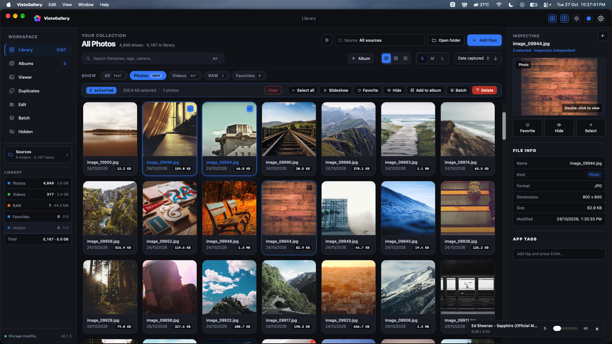
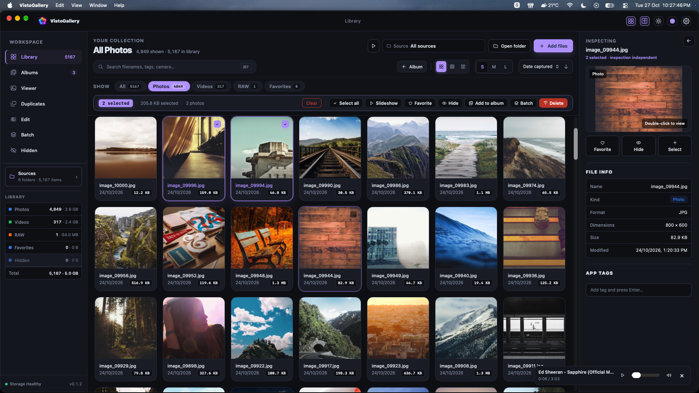
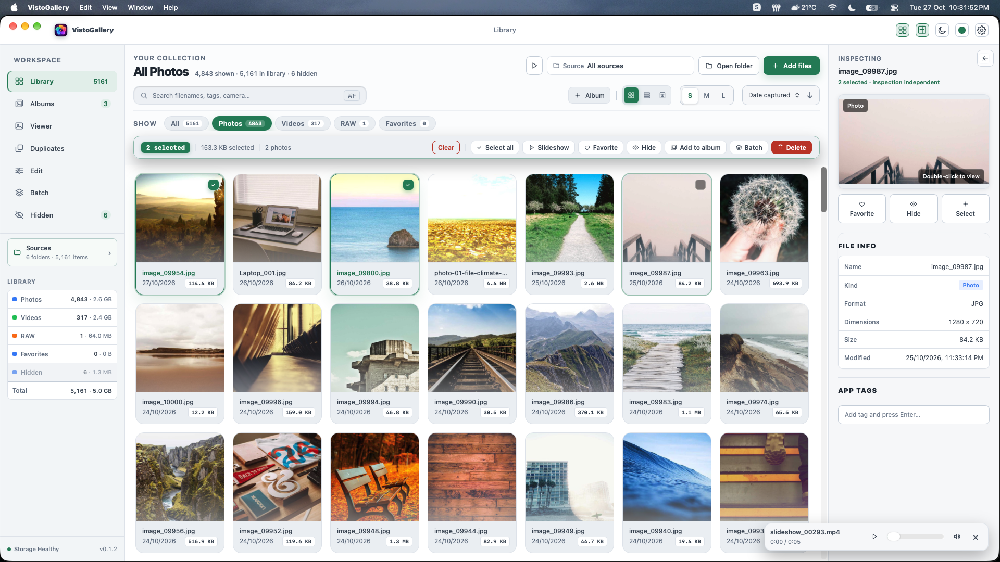
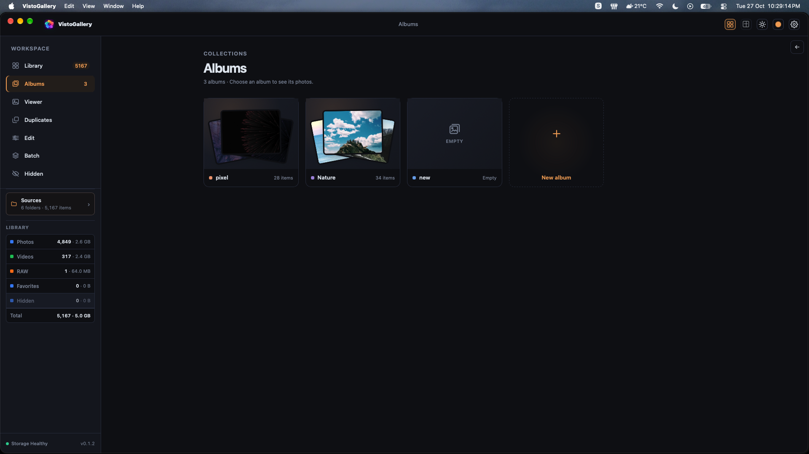
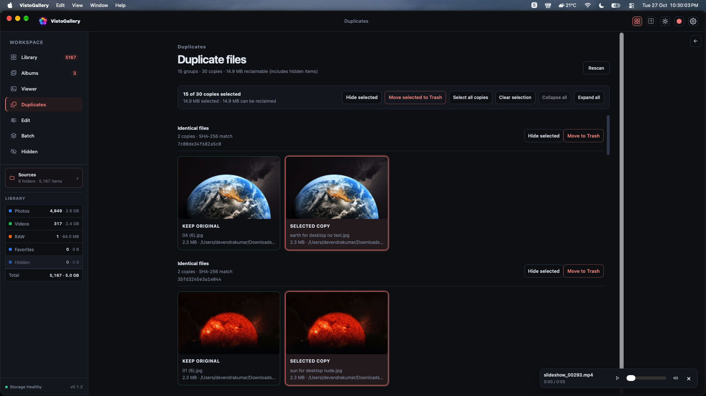
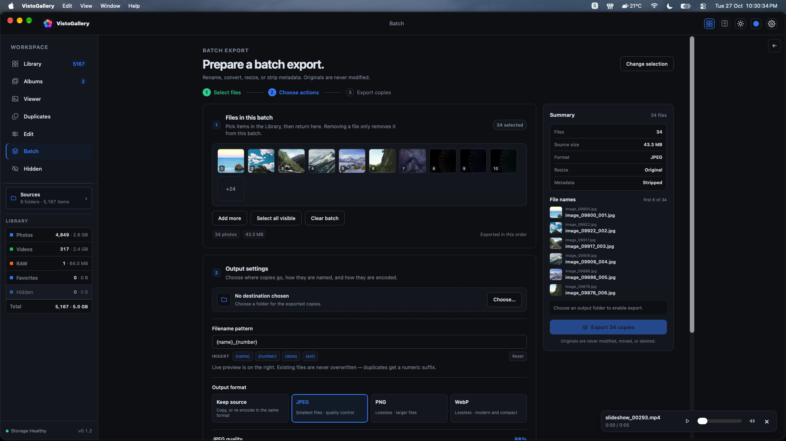
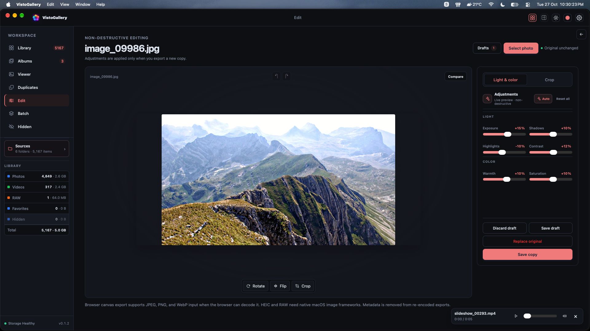
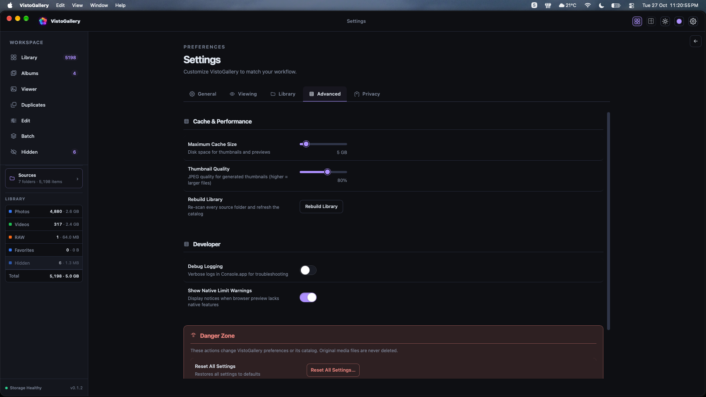

<p align="center">
  
</p>

<h1 align="center">VistoGallery</h1>

<p align="center">
  A fast, private photo & video gallery for macOS.<br/>
  Browse, edit, tag, and find duplicates — all on your disk.
</p>

<p align="center">
  <a href="https://github.com/Davin-X/visto-gallery/releases"></a>
  <a href="LICENSE"></a>
  
</p>

## Screenshots

<p align="center">
  
</p>

<p align="center">
  
</p>

<p align="center">
  
</p>

<p align="center">
  
</p>

<p align="center">
  
</p>

<p align="center">
  
</p>

<p align="center">
  
</p>

<p align="center">
  
</p>

## Features

- **Private by default** — Everything stays local. No cloud, no tracking.
- **Browse effortlessly** — Grid, Details, Timeline, Filmstrip, and Overview views
- **Organize** — Albums, tags, favorites, and hidden items
- **Edit & export** — Non-destructive edits with JPEG, PNG, HEIC, and AVIF export
- **Find duplicates** — SHA-256 powered detection with live progress & cancellation
- **Native feel** — Finder tags, Reveal in Finder, dark/light/system themes
- **Built for speed** — Fast scans, smart thumbnails, and large-library ready

## Download

Grab the latest release from [**GitHub Releases**](https://github.com/Davin-X/visto-gallery/releases).

## Build from source

```bash
npm install
npm run tauri dev    # Run in development
npm run tauri build  # Build for macOS
```

## Privacy

VistoGallery is fully local-first. It never uploads photos, metadata, or usage data. Hidden items are concealed in-app but remain at their original paths on disk.

## Contributing

See [CONTRIBUTING.md](./CONTRIBUTING.md) for setup, testing, and PR guidelines.

## Security

Report vulnerabilities via [SECURITY.md](./SECURITY.md).

## License

[MIT License](./LICENSE)
