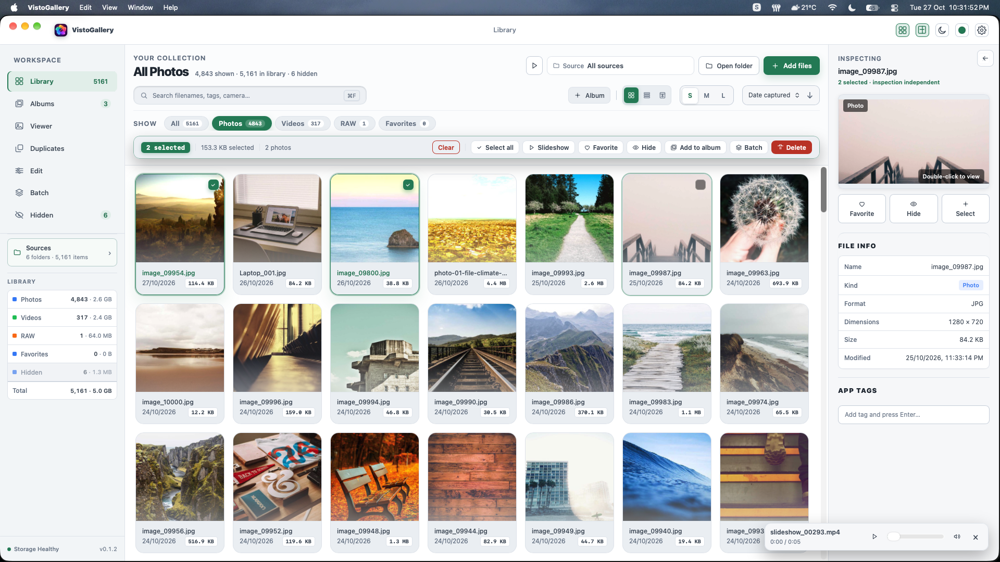
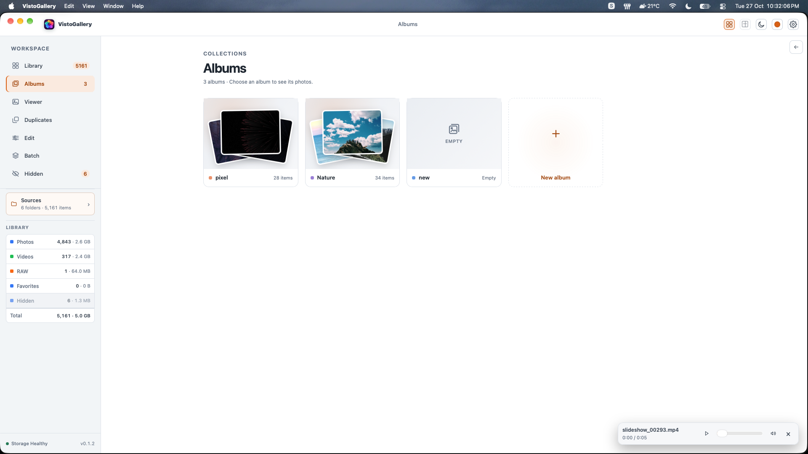
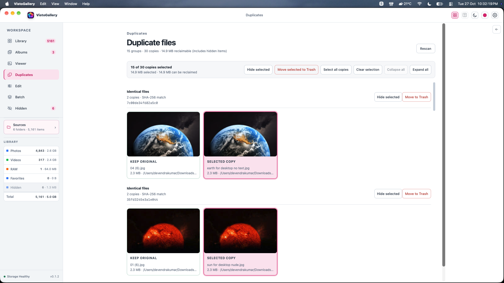
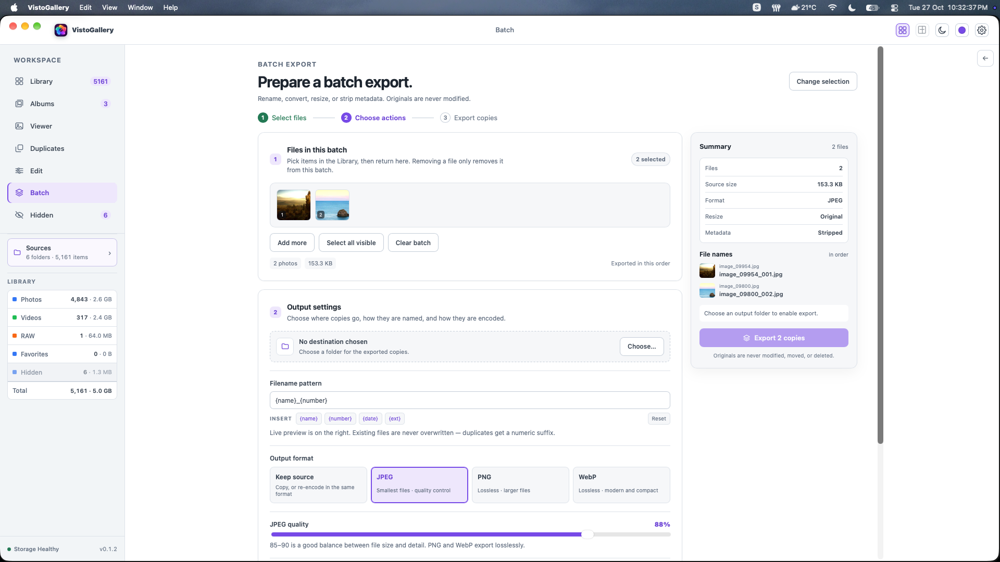
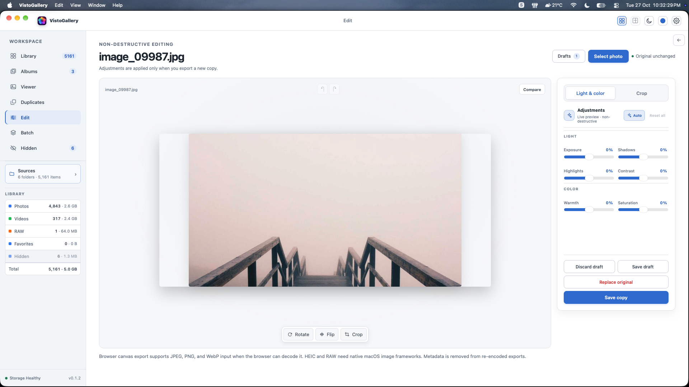
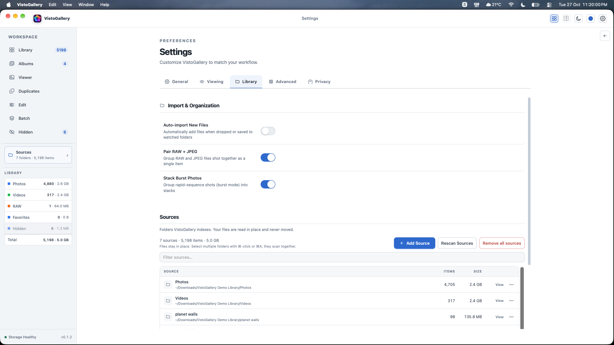

<p align="center">
  
</p>

<h1 align="center">VistoGallery</h1>

<p align="center">
  A fast, private photo & video gallery for macOS.<br/>
  Browse, edit, tag, and find duplicates — all on your disk.
</p>

<p align="center">
  <a href="https://github.com/Davin-X/visto-gallery/releases"></a>
  <a href="LICENSE"></a>
  
</p>

## Screenshots

| | |
|---|---|
|  |  |
|  |  |
|  |  |

## Features

- **Private by default** — Everything stays local. No cloud, no tracking.
- **Browse effortlessly** — Grid, Details, Timeline, Filmstrip, and Overview views
- **Organize** — Albums, Smart Albums, tags, favorites, and hidden items
- **Filter precisely** — Capture-date range, rating, color label, camera, lens, and source filters
- **Portable catalog** — Versioned catalog backup and restore without modifying original media
- **Moved libraries** — Explicit root-path mapping with preview and conflict checks
- **Edit & export** — Non-destructive edits with JPEG, PNG, HEIC, and AVIF export
- **Find duplicates** — SHA-256 powered detection with live progress & cancellation
- **Native feel** — Finder tags, Reveal in Finder, dark/light/system themes
- **Built for speed** — Fast scans, smart thumbnails, and large-library ready

## Download

Grab the latest release from [**GitHub Releases**](https://github.com/Davin-X/visto-gallery/releases).

### Install

1. Download the latest `.dmg` from GitHub Releases.
2. Open the `.dmg` and drag **VistoGallery.app** into **Applications**.
3. Eject the disk image.

### ⚠️ macOS Gatekeeper (unsigned build)

This app is **not notarized** yet. macOS may block it with a "damaged" or "unidentified developer" message. If so, run:

```bash
xattr -dr com.apple.quarantine /Applications/VistoGallery.app
```

Then open the app normally. Alternatively, right-click the app → **Open** → **Open** to bypass Gatekeeper once.

## Build from source

```bash
npm install
npm run tauri dev    # Run in development
npm run tauri build  # Build for macOS
```

## Troubleshooting

- **macOS blocks the app (“damaged” / unidentified developer):** VistoGallery is not notarized yet. See [macOS Gatekeeper (unsigned build)](#️-macos-gatekeeper-unsigned-build) for the `xattr` fix or the right-click → **Open** workaround.
- **`npm install` or build issues:** use a recent Node.js LTS version, then re-run `npm install`. If issues persist, delete `node_modules` and reinstall.
- **`npm run tauri dev` fails:** the native app requires the [Rust toolchain](https://www.rust-lang.org/tools/install). On macOS, ensure Xcode Command Line Tools are installed (`xcode-select --install`). See [CONTRIBUTING.md](./CONTRIBUTING.md) for setup details.
- **Still stuck?** Open an [issue](https://github.com/Davin-X/visto-gallery/issues) (bug/feature templates available) or start a [discussion](https://github.com/Davin-X/visto-gallery/discussions).

## Privacy

VistoGallery is fully local-first. It never uploads photos, metadata, or usage data. Hidden items are concealed in-app but remain at their original paths on disk.

## Contributing

See [CONTRIBUTING.md](./CONTRIBUTING.md) for setup, testing, and PR guidelines.

## Security

Report vulnerabilities via [SECURITY.md](./SECURITY.md).

## License

[MIT License](./LICENSE)
